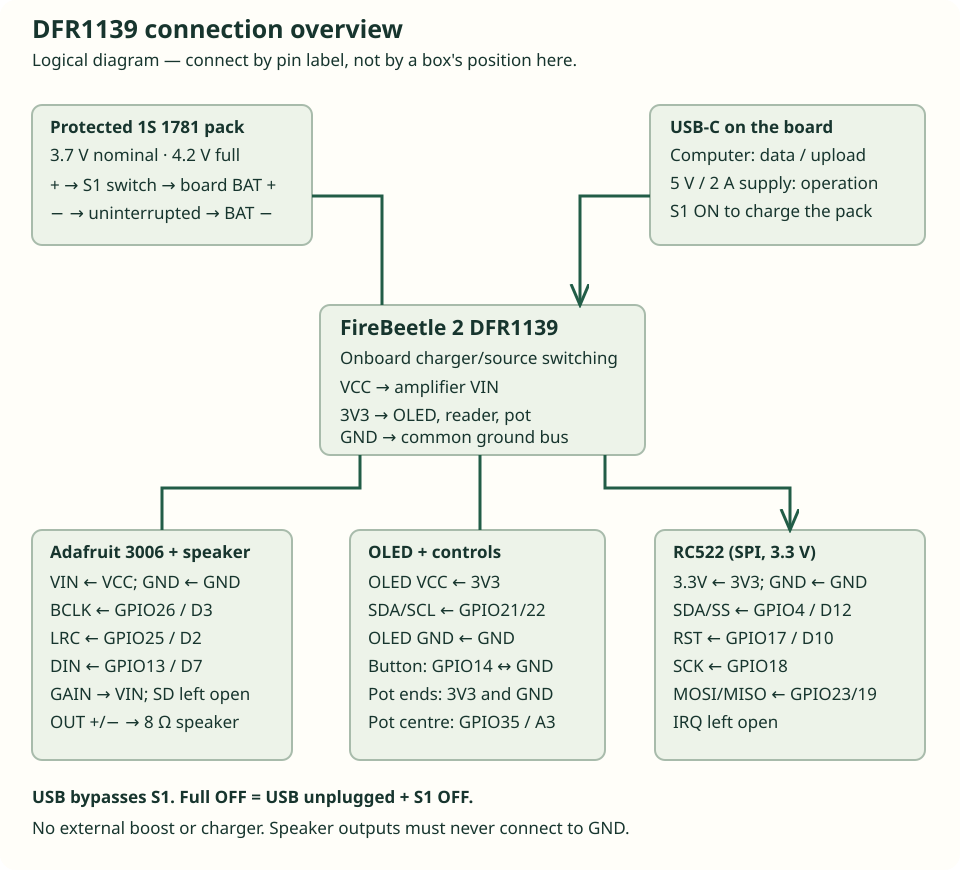

# Kangaroo Radio

Build a rechargeable Wi-Fi radio with a volume knob, station button, monochrome display and tap-to-play NFC story cards. It plays six internet stations, including ABC Kids listen in Australia, and direct audio URLs that a parent writes to tags. No subscription or SD card is required; an internet connection is.

**Before you start:** use **DFRobot DFR1139 (FireBeetle 2 ESP32-E N16R2)** and the exact parts below. Set aside a clear workbench and plan several sessions. Some soldering, a multimeter and adult assembly are required.

The source and instructions are checked together. Physical audio level, battery runtime, NFC range through the lid and a complete novice assembly still require measurement on an assembled unit. See [verification status](VALIDATION.md). This is a maker project, not a certified children's product. Do not infer an acoustic safety rating from a volume number.

[Open the illustrated guide and configuration form](https://richard-gluga.github.io/radio/) · [Download the complete unconfigured sketch](docs/downloads/KangarooRadio_ABCKids.zip)

On the website, choose **Guided build** for one stage at a time or **Full reference** to see everything. Checkmarks and shopping choices are saved in your browser; clearing browser data removes them. The wiring bench highlights one connection at a time on drawings of the boards. Turn each board to match the stated viewing orientation, then confirm its printed pin labels. The [printable pack](docs/printables.html) includes story artwork, control labels, cardboard layout pieces and a bench checklist. You can follow this README without those interactive tools.

## 1. Understand the build

You will build and check the radio in this order: identify parts → install software → test the bare board → solder and wire the peripherals → run hardware diagnostics → play radio → write a story tag → add the battery switch → mount everything in the box. **Finish the bench tests before cutting the box.**

The ESP32 connects to your router's 2.4 GHz Wi-Fi. Its I2S digital audio output feeds a MAX98357A amplifier. The amplifier drives one enclosed 8 Ω speaker. The OLED shows actual connection/playback state, and the RC522 reads the URL from a tag; the audio itself remains on the internet. A short press changes station or leaves a story. Hold-and-repeat is disabled.

The selected board already has a USB-C connector, a single-cell lithium charger and USB/battery power switching. Its **VCC output** powers the amplifier at approximately the USB supply minus a diode drop, or at battery voltage. The amplifier accepts 2.5–5.5 V. Use the board's built-in power system. Its maximum output varies with supply voltage; a 5 W speaker rating is its power-handling capacity, not a claim that this radio delivers 5 W.

The battery switch disconnects the battery's positive wire using a separate extension harness. **USB power bypasses this switch.** USB charging requires the battery switch ON. For silence while charging, turn the volume fully down. For complete power-off, unplug USB and turn the switch OFF. The operating table in section 10 repeats this deliberately.

## 2. Get the exact parts

Read the SKU, voltage and connector descriptions on the product page before ordering. Stock and prices change. The linked suppliers serve Australia where possible; the manufacturer link identifies the required part if local stock changes. Do not choose an alternative based only on its appearance.

| Qty | Part to buy | Important details | Purchase/reference |
|---|---|---|---|
| 1 | **DFRobot DFR1139**, FireBeetle 2 ESP32-E N16R2 | 16 MB flash, 2 MB PSRAM, USB-C. Headers may need soldering. | [Core Electronics](https://core-electronics.com.au/firebeetle-2-esp32-e-n16r2-iot-microcontroller-16m-flash-2m-psram-supports-wi-fi-bluetooth.html), [DFRobot](https://www.dfrobot.com/product-2837.html) |
| 1 | **Adafruit 3006**, MAX98357A I2S mono amplifier | Original breakout with VIN, GND, SD, GAIN, DIN, BCLK and LRC. Fit its headers; fit the speaker terminal if supplied loose. | [Adafruit](https://www.adafruit.com/product/3006), [Core Electronics](https://core-electronics.com.au/adafruit-i2s-3w-class-d-amplifier-breakout-max.html) |
| 1 | **Core CE08483**, enclosed **8 Ω, 5 W** speaker | 100 × 45 × 21 mm; two pre-tinned leads; built-in passive radiator. Keep its enclosure intact. | [Core Electronics](https://core-electronics.com.au/makerverse-enclosed-speaker-8-ohm-5-watt.html) |
| 1 | **DFRobot DFR0650**, 0.96-inch SSD1306 OLED | 128 × 64, factory I2C mode, address 0x3C; 30 × 30 mm board. | [Little Bird](https://littlebirdelectronics.com.au/products/monochrome-0-96-128x64-i2c-spi-oled-display), [DFRobot documentation](https://wiki.dfrobot.com/dfr0650/) |
| 1 | **SunFounder CN0090**, RC522 SPI reader module | 13.56 MHz, 3.3 V, eight-pin header. The included S50 card/key fob are **not** the story tags used here. | [DigiKey Australia](https://www.digikey.com.au/en/products/detail/sunfounder/CN0090/18668629) |
| 2 or more | **NTAG213 or NTAG215**, blank writable NDEF tags | Standard non-metal tags. Prefer card-size tags for handling; embed stickers in large, securely closed tokens. Avoid MIFARE Classic, 125 kHz, locked or password-protected tags. | [Core CE08498 NTAG213 card](https://core-electronics.com.au/rfidnfc-tag-credit-card-sized-ntag213-chip-1356mhz.html) |
| 1 | **Adafruit 1781**, protected 3.7 V 2200 mAh cylindrical Li-ion pack | Factory-fitted protection and JST-PH lead; 4.2 V charging. Manufacturer recommends ≤1 A charge and sustained discharge. About 69 × 18 mm, plus cable clearance. Buy the complete wired pack, not a loose 18650 cell. | [Little Bird](https://littlebirdelectronics.com.au/products/lithium-ion-cylindrical-battery-3-7v-2200mah), [Adafruit specifications](https://www.adafruit.com/product/1781) |
| 1 | **Jaycar ST0579**, SPST toggle switch | Maintained ON/OFF, panel mount, two terminals; rated 20 A at 12 V DC. This is a contact rating, not the radio's current draw. For the battery harness only. | [Jaycar](https://www.jaycar.com.au/spst-20a-12vdc-toggle-switch/p/ST0579) |
| 1 | **Jaycar SP0710**, normally-open momentary pushbutton | Two-terminal panel button; not a latching switch or bare four-leg tactile switch. | [Jaycar](https://www.jaycar.com.au/red-miniature-pushbutton-spst-momentary-action-125v-1a-rating/p/SP0710) |
| 1 | **SparkFun COM-09939**, 10 kΩ linear potentiometer | Three terminals; 6 mm, 18-tooth shaft in the current drawing. M7 × 0.75 mounting bushing: obtain its matching nut/washer if not supplied. A ¼-inch shaft is not identical to 6 mm. | [SparkFun](https://www.sparkfun.com/rotary-potentiometer-10k-ohm-linear.html) |
| 1 | **Adafruit 2047** white T18 potentiometer knob | 6 mm, 18-tooth push-fit; matches the specified pot shaft. Check retention before use. | [Adafruit](https://www.adafruit.com/product/2047) |
| 1 | **Adafruit 1131**, JST-PH battery extension | 2.0 mm pitch, two pins, male-to-female, 500 mm, 26 AWG. Verify polarity as described in section 10; matching housings alone do not prove it. | [Adafruit](https://www.adafruit.com/product/1131), [Little Bird](https://littlebirdelectronics.com.au/products/jst-ph-battery-extension-cable-500mm) |
| 1 pack each | 2.54 mm jumper leads: female-to-female and male-to-female | Short, preferably 10–15 cm. Used for signal wiring and the bench setup. | Buy both stated connector types. |
| 1 each | Solderless breadboard **and** solderable protoboard | Breadboard for bench distribution; insulated, soldered connections for the final enclosure. A 400-tie-point breadboard is sufficient if modules sit beside it. | Standard 2.54 mm spacing. |
| As needed | Male pin header, 22 AWG stranded insulated wire, heat-shrink, electronics solder, cable ties, nylon spacers/screws/washers | Red for positive, black for ground; several colours for signals. Obtain M2 hardware for the OLED. | Match mounting holes on the received parts. |
| 1 | USB-A-to-USB-C **data** cable and regulated **5 V, 2 A** USB supply | Use the computer USB port for programming; use the wall supply for final operation/charging. No external voltage connection to VCC. | Reputable Australian-compliant USB supply. |
| 1 | Non-metal enclosure with removable, screw-secured lid | At least **200 × 140 × 80 mm usable internal space**, with a thin non-metal region over the NFC antenna. Larger is easier. | Buy by internal dimensions, not a generic craft-box photo. |
| As needed | Speaker grille/cloth, foam gasket, insulating base sheet and battery retaining strap | Grille must protect both the cone and passive radiator; strap must not crush the battery. | No loose magnets or detachable small token parts. |

Make a basket containing **every row**, then add delivery and any missing tools. Check current prices with the linked suppliers. Buy the enclosure after confirming that everything fits.

### Tools and skills

Use a temperature-controlled soldering iron and stand, electronics solder/flux, side cutters, wire strippers, small screwdrivers, a multimeter with DC-voltage/resistance/continuity modes, ruler, eye protection, drill and a file or small saw. Practise on spare wire first using [Adafruit's soldering guide](https://learn.adafruit.com/adafruit-guide-excellent-soldering). Solder and drill in a ventilated work area away from children. Unplug USB and disconnect the battery before changing wiring. Never solder onto the battery or cut its factory leads.

You need a Windows, macOS or Linux computer with Arduino IDE support, internet access, your Wi-Fi name/password, and an NFC-writing-capable phone for story tags. On Android enable NFC in settings. On iPhone verify that NFC Tools supports writing on your model; not every phone can write tags.

## 3. Identify connections before applying power

Open the [DFR1139 pinout and schematic](https://wiki.dfrobot.com/dfr1139/). Confirm **N16R2 / DFR1139** on the product packaging and a module with 2 MB PSRAM. Some DFRobot page headings mistakenly say N16R8; the SKU and technical specifications identify N16R2. Use the exact purchased board, not a picture of another FireBeetle.

“GPIO” means the chip's numbered input/output connection. The board also has labels such as **D7** or **A3**. The table below gives both. These are not physical pin positions. VCC and 3V3 are different supplies. GND is the common electrical reference, not either speaker output.

GPIO16/NC is reserved; do not connect it. GPIO34/A2 is already wired to the battery-measurement divider; do not attach the volume pot there. GPIO27 and GPIO5 are used onboard. Leave all four unused.

On the amplifier, identify the **two speaker output terminals** separately from GND. Neither speaker lead connects to GND. On the RC522 the pin labelled **SDA** is the **SPI chip-select** pin in this build; it does not connect to the OLED's SDA.

### Solder the module headers

Keep all power disconnected. Fit straight male headers to the board, amplifier, reader and display where they are supplied loose. Insert the short ends through the PCB; solder each pad separately, keeping the long ends available for jumper sockets. Follow [Adafruit's amplifier assembly guide](https://learn.adafruit.com/adafruit-max98357-i2s-class-d-mono-amp/assembly). Check for bridges between adjacent pins with a bright light and magnifier. Let joints cool and gently check mechanical security. Do not hold a connector in place by friction against an unsoldered pad.

For the final build, solder wire to the switch/button/pot lugs, slide heat-shrink over each joint and shrink it. Do this while the wires are disconnected from the radio. Bench jumpers are useful for testing but need secure termination and strain relief before portable use.

## 4. Install the exact software

A **sketch** is the folder of source files Arduino compiles and uploads to the board. A **library** provides code for one of the modules. Compilation checks the code; uploading transfers the compiled result over the USB data cable.

1. Install **Arduino IDE 2** from [arduino.cc](https://www.arduino.cc/en/software). Allow installation to finish. Do not use the web editor for this recipe.
2. Open **File → Preferences** on Windows/Linux, or **Arduino IDE → Settings** on macOS. In **Additional boards manager URLs**, add `https://espressif.github.io/arduino-esp32/package_esp32_index.json`. Preserve any URLs already there. Save.
3. Open **Tools → Board → Boards Manager**. Search `esp32`. Select **esp32 by Espressif Systems**, choose version **3.3.12** in its version selector, and install. This is a large download; wait until installation completes. Do not install a different similarly named package.
4. Open **Tools → Manage Libraries** (or the Library Manager sidebar). Install the five exact versions below. If offered dependencies, choose **Install all**, then check their versions. Use each entry's version selector; do not accept an automatic upgrade for this recipe.

| Library Manager name | Author / identifying project | Version |
|---|---|---|
| ESP32-audioI2S-master (search `ESP32-audioI2S`) | schreibfaul1 | **4.0.0** |
| Adafruit SSD1306 | Adafruit | **2.5.17** |
| Adafruit GFX Library | Adafruit | **1.12.6** |
| Adafruit BusIO | Adafruit | **1.17.4** |
| MFRC522 | GithubCommunity / miguelbalboa | **1.4.12** |

5. Connect **only the bare FireBeetle** to the computer using the USB data cable. Leave the battery and all peripherals disconnected for this first test. An LED may flash because there is no battery; that alone is not a fault.
6. Select **Tools → Board → esp32 → ESP32 Dev Module**. This generic entry is intentional; the sketch uses raw GPIO numbers. Use the board package and version listed above.
7. Set the following Tools menu options. Other settings can remain at their defaults.

| Setting | Value |
|---|---|
| CPU Frequency | **240MHz (WiFi/BT)** |
| Flash Mode | **DIO** |
| Flash Frequency | **80MHz** |
| Flash Size | **16MB (128Mb)** |
| Partition Scheme | **16M Flash (3MB APP/9.9MB FATFS)** |
| PSRAM | **Enabled** |
| Upload Speed | **115200** |
| Core Debug Level | **None** |
| Port | The port that appears when this board is connected |

8. If the port is unclear, unplug the board, inspect **Tools → Port**, plug it in again and select the newly appearing entry. Windows names it `COM…`; macOS often `/dev/cu.wchusbserial…`; Linux often `/dev/ttyUSB…`. Do not choose Bluetooth ports. If none appears, first try a known data cable and another USB port. Then use the **CH340 driver linked by [DFRobot](https://wiki.dfrobot.com/dfr1139/)** for your operating system. Linux may require permission to access the serial port; follow [Arduino's Linux port-permission instructions](https://support.arduino.cc/hc/en-us/articles/360016495679-Fix-port-access-on-Linux).
9. Download the **complete sketch ZIP** using the website configuration form, choosing **Hardware test** for now. If the form is unavailable, download [the unconfigured ZIP](docs/downloads/KangarooRadio_ABCKids.zip), extract it, and change `HARDWARE_TEST` to `true` in `RadioConfig.h`. Wi-Fi values are not used in hardware-test mode.
10. Extract the ZIP using **Extract All** on Windows or by opening it on macOS/Linux. Inside is a folder named `KangarooRadio_ABCKids`. Keep its `.ino` and all `.h` files together. Open **`KangarooRadio_ABCKids.ino` inside that folder**. Do not open it inside a ZIP viewer or paste only the `.ino` into a new sketch.
11. Click the checkmark **Verify**. The first compile may take several minutes. If it reports a missing header, return to the library table. `Sketch too big` means the partition setting is wrong. Do not proceed until verification finishes without an error.
12. Click **Upload** and wait for it to finish. The board may reset automatically. If upload stays at `Connecting…`, verify the port and cable, close any other serial program, and retry. On this board the onboard **user button is GPIO27, not BOOT**. If automatic entry still fails, unplug power, temporarily connect **GPIO0/D5 to GND**, reconnect USB and upload; then unplug USB, remove that jumper and reconnect. Never leave GPIO0 grounded for normal use.
13. Open **Tools → Serial Monitor**, set **115200 baud**, and press the board's RST button. Expect a startup banner and **`PSRAM: OK (2097152 bytes)`**. OLED/RC522 “NOT FOUND” messages are expected while those modules are disconnected. If PSRAM is missing, stop: verify DFR1139, PSRAM Enabled and the board selection. More flash storage is not a substitute for PSRAM.

**Checkpoint:** the bare board uploads and reports PSRAM before you connect anything else. Unplug USB again.

## 5. Wire the display, knob, button and reader

Use the breadboard only to distribute **3V3 and GND** during the bench test. With the board and battery disconnected, identify which holes are joined using continuity mode: rows of five holes are usually joined, the centre gap separates them, and long power rails may be split in the middle. Join a split rail only if continuity shows it is split. Mark the chosen rails **3V3** and **GND**. Connect one board 3V3 pin to the 3V3 rail and one GND pin to GND. A plus sign on a breadboard does not make it 5 V; the supplied voltage determines it.

Never place two wires in one jumper socket. Each module gets its own lead to the appropriate rail. Keep SPI and I2S leads short, preferably under 15 cm. When reading the tables, **unconnected means leave that pin without a wire**.

| Component pin | Connect to DFR1139 / distribution rail |
|---|---|
| OLED VCC | **3V3** rail |
| OLED GND | GND rail |
| OLED SCL | **GPIO22 / SCL** |
| OLED SDA | **GPIO21 / SDA** |
| OLED D/C and CS | Unconnected; leave factory I2C solder configuration unchanged |
| RC522 3.3V | **3V3** rail; never VCC/USB 5 V |
| RC522 GND | GND rail |
| RC522 SDA / SS | **GPIO4 / D12** |
| RC522 SCK | **GPIO18 / SCK** |
| RC522 MOSI | **GPIO23 / MOSI** |
| RC522 MISO | **GPIO19 / MISO** |
| RC522 RST | **GPIO17 / D10** |
| RC522 IRQ | Unconnected |
| Station button terminal 1 | **GPIO14 / D6** |
| Station button terminal 2 | GND rail; no external resistor required |
| Potentiometer middle lug (wiper) | **GPIO35 / A3** |
| Potentiometer outer lugs | One to **3V3**, the other to GND |

The two-terminal button has no polarity. Use the multimeter before wiring: it should be open when released and nearly zero ohms while pressed. The pot should measure approximately 10 kΩ between its outer lugs, and a changing resistance from middle to either outer lug. If turning the knob clockwise later makes the number decrease, disconnect power and swap **only its two outer wires**. Do not change the centre wire.

Connect the OLED first, reconnect USB and confirm **`OLED: OK (0x3C)`** and a visible hardware-test screen. Unplug USB before adding the pot/button, and test them next. Then unplug USB, connect the RC522 and test again. Missing OLED or reader hardware does not deliberately crash the firmware; use its Serial messages to find the fault.

**Checkpoint:** in Hardware test mode, the knob reading moves from near 0 towards 4095, the volume reaches 0 and the selected cap, and the button count increases exactly once per press/release. The ESP32 ADC may reach its maximum before the last few degrees of knob travel; that is normal. The reader reports a version other than `0x00`/`0xFF`. Leave the battery disconnected.

## 6. Add the amplifier and speaker

Unplug USB. Place the amplifier beside the breadboard. Fit the speaker's two leads into the amplifier's two output screw terminals, tighten them and gently tug each lead. No bare conductor should protrude far enough to touch the other terminal. The enclosed speaker has two moving areas; one is a passive radiator, not a second electrical speaker.

| Amplifier pin | Connect to |
|---|---|
| VIN | **DFR1139 VCC**, using a short 22 AWG power lead |
| GND | Common GND, using a short 22 AWG lead |
| BCLK | **GPIO26 / D3** |
| LRC / LRCLK / WS | **GPIO25 / D2** |
| DIN | **GPIO13 / D7** |
| GAIN | **Amplifier VIN** (6 dB gain on Adafruit 3006) |
| SD | Unconnected; the board's default enables audio |
| Speaker + and − terminals | The two speaker leads only; **neither goes to GND** |

For the two 22 AWG power leads, solder to the underside of the labelled VCC/GND pads on the FireBeetle and VIN/GND pads on the amplifier, where the header pins pass through. Leave no loose strands; inspect for bridges to adjacent pads. Keep the leads under 15 cm, support them so they cannot pull on a pad, and insulate the board undersides. Do not try to push stranded wire into a female jumper socket. The board GND header still connects to the signal-ground rail. Solder a short insulated GAIN-to-VIN link on the amplifier while it is unpowered; check that it touches only those two pads. The firmware mixes stereo audio to mono. Do not attach headphones or another amplifier to the speaker terminals.

**Power check:** use the multimeter in **DC volts**, with black lead in COM and red in V/Ω, not the current socket. Before connecting amplifier VIN, power the board from USB and measure between VCC and GND: expect roughly 4.5–5.0 V. Measure 3V3 to GND: approximately 3.3 V. Avoid bridging adjacent pins with a probe. Unplug USB, complete the amplifier power connection and inspect again. Never connect a battery directly to the board's 3V3 pin.



## 7. Configure and play internet radio

1. On the website configuration form, enter the exact **2.4 GHz Wi-Fi name and password**. Names and passwords are case-sensitive; spaces count. A combined 2.4/5 GHz router name can work if its 2.4 GHz service is enabled. Guest networks with a browser login page, enterprise authentication and WPA3-only networks are outside this recipe. Use WPA2-Personal or compatible mixed mode.
2. Optionally enter a second network, such as a phone hotspot. Enable the hotspot's 2.4 GHz/compatibility mode and keep it awake during testing. Leave both backup fields empty if unused. The radio tries home for 12 seconds, backup for 12 seconds if supplied, then retries after a pause. It needs internet access, not just a Wi-Fi signal.
3. Choose a startup station and a maximum volume step. Start with **10 of 21 or less**, with the physical knob fully down. This setting is a limit on the software control; it is **not** a measured sound level. Choose **Normal radio** mode and download a new complete ZIP. The form escapes quotation marks/backslashes and allows an intentionally empty Wi-Fi password. It processes credentials locally without saving them in browser storage.
4. Extract to a fresh folder, close the earlier sketch window and open the new `.ino`. Confirm that `RadioConfig.h` contains your intended settings and `HARDWARE_TEST = false`. Treat this folder as private because it contains the Wi-Fi password. Do not upload it to GitHub.
5. Recheck the Tools settings from section 4, keep the battery disconnected, plug in USB and upload. Open Serial Monitor at 115200. Look for **OLED OK**, **RC522 OK**, **PSRAM OK**, **WIFI: connected** and audio messages. Initial connection can take several seconds; a slow network takes longer.
6. Raise the knob a little. You should hear the selected station and see **Playing**. If the computer's USB port resets under audio load, unplug it and use the specified 5 V/2 A wall supply for playback. Do not connect two power supplies to board pins.
7. Press and release the station button: it selects the next station. Holding it does not keep cycling. The user interface remains active while audio connects, but an in-progress DNS/TLS operation can take several seconds to finish before a newer audio selection starts. No “instant switch” guarantee is made.

If the form is unavailable, open `RadioConfig.h` in the extracted sketch using its Arduino IDE tab. Replace `YOUR_WIFI_SSID` and `YOUR_WIFI_PASSWORD` between the double quotes; preserve the quotes and semicolons. Leave both backup strings `""` if unused. `START_STATION` is numbered 0–5 in the table order below, `MAX_VOLUME` is 0–21, and `HARDWARE_TEST` must be `false` for playback. Save, Verify and Upload. Inside these C++ strings, write a literal double quote as `\"` and a literal backslash as `\\`; do not replace characters with typographic “smart quotes”. The form performs this escaping automatically.

The OLED reports Connecting, Waiting for decoder, Playing, or an error. Internet-radio failures retry with delays up to 30 seconds. A bad story URL stays in an error state until you tap another tag or press the station button. Display strings are limited to the screen width; full diagnostic messages appear in Serial Monitor.

| Station | Official page / availability |
|---|---|
| ABC Kids listen | [ABC](https://www.abc.net.au/listen/live/kidslisten); online/DAB+, not an AM/FM frequency. Australian IP address required for its stream. |
| Fun Kids UK | [Fun Kids](https://www.funkidslive.com/); external live programming and advertising may change. |
| Fun Kids Junior | [Fun Kids](https://www.funkidslive.com/); separate stream aimed at younger listeners. |
| Rock the Cradle | [The Current / MPR](https://www.thecurrent.org/playlist/rockthecradle) |
| Positively Sleep | [Positivity Radio](https://positivity.radio/); select Sleep Kids in its current player. |
| ABC Classic | [ABC Classic](https://www.abc.net.au/listen/live/classic); general classical programming, not a children's-only service. |

Parents should listen and choose appropriate stations themselves. A fixed station list cannot guarantee the content of somebody else's live broadcast. ABC's geographic limitation is documented in [its access guidance](https://help.abc.net.au/hc/en-us/articles/360001184395-How-can-I-access-ABC-Kids-listen). Stream addresses can change; maintainers update the single `Stations.h` list and regenerate the website.

**Checkpoint:** every chosen station plays, the knob mutes at minimum, one button press selects one station, and switching off the router produces an understandable state followed by recovery when it returns. Test a deliberately incorrect password once if you want to practise recovery: generate correct settings and upload again; there is no web setup portal.

## 8. Write and test a story card

Start with the project's original **five-second audio-check WAV**, a quiet synthetic sequence created by the included script. It is not a book narration, an ABC programme or an acoustic calibration signal. Turn volume down before testing any new file.

Test URL to write to the tag:

```text
https://richard-gluga.github.io/radio/assets/audio-check.wav
```

**Check the URL:** open it on your phone first. If it is unavailable, use a working public direct audio URL you control. The website's “Copy demo URL” button uses its actual hosting address. A file path such as `assets/audio-check.wav` or a `localhost` URL is not a usable internet URL for the radio.

1. Install **NFC Tools by wakdev** from the phone's app store, using the links on [the developer's site](https://www.wakdev.com/en/apps/nfc-tools.html). Check that your phone supports NFC writing.
2. Use **Read** to identify the tag. It must be a writable NTAG213 or NTAG215. A reader kit's MIFARE Classic/S50 card is not interchangeable with these tags.
3. In **Write**, remove any previously queued records. Choose **Add a record → URL/URI**, paste the complete `https://…` URL, confirm, then choose **Write**. Hold the tag at the phone's NFC antenna until success. Labels differ slightly between app versions. Write a URL record, not a text record containing a URL. Do not choose permanent locking or password protection.
4. Read the tag back and compare the complete URL, including filename and extension. Keep the original URL somewhere you can edit later. Remove the phone from the tag.
5. With radio Wi-Fi connected, place the tag near the RC522 antenna for about a second. Keep it still. Remove it after the radio responds. To play the same tag again, remove and present it again; leaving it resting on the reader does not restart it continuously.
6. Hear the five-second check, then observe **End of audio** and return to the previous radio station after four seconds. Times come from the audio library and are approximate (`left~`); sources without a duration show **unknown**. End means the source stopped, not proof that every byte arrived. A connection that never starts or ends substantially before its reported duration remains in an error state for you to retry.
7. During playback, press the station button to return to the previous radio station. A subsequent press advances to the next station. A bad or incomplete tag should display an error and leave existing playback alone.

Once the short check works, give your first card a story: **Pip and the little light**, an original approximately 45-second story with computer narration. [Listen to the WAV](docs/assets/pip-and-the-little-light.wav), [read the transcript](docs/assets/pip-and-the-little-light.txt), and [print its card artwork](docs/printables.html#cards). Use **Copy story URL** on the website, open that URL on your phone, then write it as the card's single URL/URI record. The artwork alone does not create an NFC tag. Test the complete story on the radio; browser playback verifies only the browser path.

For your own stories, host an MP3 file with permission to distribute it. A conservative starting format is mono or stereo MP3 at 44.1 kHz, 128 kbps constant bitrate. A direct HTTPS file link should return audio without a login, expiring access token, HTML download page or DRM. YouTube/Spotify/share-page URLs are not direct audio URLs. Browser playback does not prove ESP32 decoder/TLS compatibility: test the actual radio. HTTP is accepted but is unencrypted; prefer HTTPS. The firmware does not provide a content filter or guarantee authenticated TLS; do not use private or sensitive recordings/URLs with this tutorial's audio transport.

An NTAG213 has less storage than an NTAG215. The URL must fit both the tag's NDEF capacity and this firmware's **255-byte URL limit** after expanding the URI prefix. If the phone says it is too large, shorten the URL or use NTAG215; do not expect truncation to work. Percent-encode spaces/non-ASCII characters in the URL. The parser rejects chunked records, incomplete reads, unsupported reserved-memory layouts and multiple URI records; one URL record per tag is the supported recipe.

The optional browser preview is a convenience, not a phone NFC writer or a simulation of measured hardware performance. Its custom URL requires appropriate server support; browser CORS restrictions can differ from the ESP32's networking behavior.

## 9. Set a listening level responsibly

Start with the knob at minimum and increase it only enough for clear listening. Keep the radio away from ears. Check the loudest programme/file you intend to use, with both USB power and a fully charged battery; the supply voltage can change the available output. Lower the configured maximum and re-upload if needed.

A value such as `MAX_VOLUME = 10` describes the audio library's volume scale. It cannot establish dBA at a listener's ear. Measuring a limit requires a sound-level meter, a specified distance, representative loud material and the completed enclosure. Record those conditions rather than labelling a percentage “safe”. See [WHO safe-listening guidance](https://www.who.int/publications-detail-redirect/9789241515276). This project does not certify hearing protection.

## 10. Add rechargeable battery power

Finish the USB tests first. Use **only the protected single-cell Adafruit 1781 battery specified above** for this recipe. Do not substitute a 9 V alkaline, a two-cell/7.4 V pack, LiFePO4 or a bare unprotected cell. Keep the battery disconnected and away from the soldering area while making the harness.

### Make and inspect the switch harness

1. Take the **separate JST-PH extension cable**, with nothing plugged into either end. Confirm it is a two-pin PH extension, not an adapter to another series. Dry-fit the empty board end gently, then remove it. Do not force the connector.
2. Use continuity mode to identify which contact at one end connects to which at the other. The cable must preserve positive and negative to the board's marked **+ and −** contacts. Connector colour and the fact that it fits do not establish polarity. Check the board's battery symbol/pinout with a magnifier if necessary.
3. Cut **only the extension's positive conductor**, not the battery's factory lead. Strip about 4 mm from the two cut ends. Put a piece of heat-shrink onto each wire before soldering.
4. Solder one cut end to each ST0579 terminal. Cover both solder joints completely with heat-shrink. Leave the extension's negative conductor uninterrupted. Secure the harness so movement does not pull on solder joints.
5. With the harness alone, test continuity: positive goes end-to-end only when the switch is ON; negative goes end-to-end in both positions; positive must never be connected to negative. Mark the ON position on the switch or panel. Do not use resistance/continuity mode on a powered battery.
6. Set the meter to DC volts, black lead in COM and red in V/Ω. With USB unplugged and the harness **not connected to the board**, plug the battery into the harness, turn the switch ON, and carefully measure the two board-end contacts. The red probe on the contact that will meet board **+** must show a **positive voltage**, typically 3.5–4.2 V. Keep probes apart; do not bridge the contacts. If the reading is negative, zero, over 4.2 V, or you cannot identify polarity confidently, disconnect and correct/replace the extension before proceeding. Do not alter the battery connector while it is live.
7. Turn the switch OFF. Insert the harness into the board's PH battery socket, matching polarity. Turn volume fully down and switch ON. The radio should boot from battery. If it resets or the battery is below the board's supported operating range, switch OFF and proceed to supervised charging. Never repeatedly run the battery into its protection cutoff.

The DFR1139 has onboard charging and source switching; no second charger is connected in parallel. Its [published schematic](https://dfimg.dfrobot.com/wiki/20495/DFR1139_firebeetle-2-esp32-e-n16r8_schematics_v1.0.pdf) uses a TP4056X with a 2 kΩ programming resistor (approximately 0.6 A nominal charge current; actual current can be lower due to thermal regulation). That is below Adafruit's recommended **1 A maximum charging rate for pack 1781**. Keep sustained battery-path current below 1 A; the software volume cap alone is not a current limiter. A different battery needs its own charge-current specification check. The pack's own protection is a last-resort backup, not a fuel gauge.

### Charge and operate

Use the board's USB-C port and the regulated 5 V/2 A wall supply. Turn the battery switch **ON** to connect the pack for charging. Charge with an adult present on a non-flammable surface, with access to inspect the battery and electronics. The board's red charge indicator is on while charging and off when full or not charging; it may flash when no battery is attached. Off alone does not prove a battery is full. There is no promised charge time or calibrated battery-percentage display.

| USB cable | Battery switch | Result |
|---|---|---|
| Unplugged | OFF | Radio off; battery isolated |
| Unplugged | ON | Radio runs from battery |
| Plugged in | OFF | Radio runs from USB; **battery does not charge** |
| Plugged in | ON | Radio runs from USB and the onboard circuit charges the battery |

Turn the volume to zero for silent charging. Disconnect USB and turn the battery switch OFF for complete power-off. Both USB and the battery may be connected **to this board's intended ports**; do not generalize that to other boards or add power to VCC/3V3.

Stop use if the battery swells, is damaged, smells unusual or becomes hot. Do not charge a damaged pack. Do not enclose it against a sharp edge, screw tip, hot amplifier or solder joint. A removable, tool-secured lid permits adult inspection. Keep the battery, reader, wires and token components inaccessible to young children. There is no measured runtime claim; determine yours with the completed radio at your normal level.

**Checkpoint:** test all four rows of the table, playback on battery, charging behavior and reconnection after switching off. Confirm the pack and wiring stay within their ratings and do not become hot before enclosing them.

## 11. Build the enclosure after the bench works

Use a box with at least 200 × 140 × 80 mm **clear internal** space. Make a cardboard layout first: the speaker needs 100 × 45 × 21 mm, the battery is about 69 mm long and 18 mm in diameter, the OLED PCB is 30 × 30 mm, and the FireBeetle is about 60 × 25.4 mm. Allow additional space for connectors, bent wires, switch bodies and service access. Do not stack boards on the battery.

1. Remove all electronics and the battery before drilling. Mark front positions for the speaker grille, OLED, knob and station button, and a side/rear position for the power switch and USB-C access. Place the RC522 behind the top/lid with its antenna facing the tapping surface. Keep metal fasteners, speaker magnets and the battery away from the reader antenna; test the actual layout for reliable reads.
2. The CE08483 speaker is already enclosed. Keep its case intact and provide openings for **both** its 35 mm moving areas (speaker and passive radiator), with a grille spanning them. Its mounting pattern is 91.2 × 36.2 mm with 6 mm holes; use the received part to transfer centres, and check clearances before cutting. Do not block the radiator, glue onto a cone. A foam gasket can reduce rattles. The outer wooden box does not guarantee more bass.
3. Mark the OLED window from the actual display. The lit area is about 21.7 × 10.9 mm; keep all of it visible while leaving material to support the 30 mm PCB. Mount with M2 hardware/spacers without pressing on its glass. Add a clear protective window if needed. Do not cut a hole solely from the nominal “0.96-inch” diagonal.
4. Transfer the threaded-shaft diameters of the actual pot/button/switch to the panel. The current COM-09939 drawing specifies an M7 bushing and a 6 mm shaft; the bushing, not the shaft, goes through the mounting hole. Its threaded section is short: use a thin inset mounting panel or recess a thick wooden wall so a washer and nut can engage fully. Fit the knob only after tightening the pot nut; align its mark to minimum with the pot fully anticlockwise. Drill a small pilot hole, enlarge gradually and dry-fit with washers and nuts. A generic 6/7/12 mm hole is not correct for every part. Keep enough thread exposed to secure each nut without overtightening.
5. Provide an accessible opening for the USB-C plug **including its moulded body**, not just the metal socket. Secure the FireBeetle on spacers so plugging in a cable cannot bend the board. Do not rely on hot glue around a connector to take insertion forces.
6. Mount the reader under a thin non-metal lid section. Start with about 2–3 mm wood/plastic over the antenna and test your tags through it before permanent fixing; no universal reading distance is promised. Do not use a metal lid or metal-backed tags in this recipe.
7. Transfer the bench wiring to secure, soldered connections on an insulated protoboard/distribution strip. Mark separate GND and 3V3 buses and check them with continuity while unpowered. Run VCC-to-amplifier power separately with short 22 AWG leads. Follow the tables again, connection by connection. Do not put VCC on the 3V3 bus. Keep the underside of every PCB insulated from other components.
8. Secure the battery using a broad nonconductive strap or supported pocket with no pressure on its protective wrapping or lead exit; prevent the cylindrical pack from rolling. Leave room for inspection; do not glue, screw through or tightly clamp it. Restrain the harness and signal wires separately. Ensure no screw can reach the battery even if the enclosure is squeezed.
9. Re-run every bench checkpoint with the lid open, then with it closed. Check NFC reliability, Wi-Fi reception, sound, button/knob travel, charging access and absence of rattles. Reopen and inspect for pinched wires before tightening the lid screws. Only then make decorative tokens or labels.

The connection overview is a logical diagram, not a photograph or a manufacturing drawing. The illustrations show connections and planning dimensions; physical assembly still needs verification. Keep a record of your actual layout and measurements if you publish a build report.

## 12. Troubleshooting by symptom

| Symptom | Check in this order |
|---|---|
| No USB port | Known data cable → another port → CH340 driver → Linux port permission. Disconnect external wiring while diagnosing. |
| Upload cannot connect | Correct board/port → close other serial tools → reset → GPIO0-to-GND upload procedure in section 4. Remove the jumper afterward. |
| Missing `Audio.h`, `MFRC522.h` or another header | Install the exact library and version from section 4. Keep every sketch header in the same folder. |
| Compile errors after a library/core update | Restore pinned versions. Download the complete sketch again if files are missing. |
| “Sketch too big” | Select the specified 3 MB application partition, then Verify again. |
| `PSRAM: MISSING` | DFR1139 hardware → ESP32 Dev Module → PSRAM Enabled → re-upload. |
| OLED blank | 3V3/GND → pin labels → GPIO21/22 → I2C mode and 0x3C. Run Hardware test; inspect solder joints. Never swap wires while powered. |
| RC522 version 00/FF | 3.3 V, shared GND, SDA-to-GPIO4, RST-to-GPIO17, SPI wires and soldered header. Keep wires short. |
| Knob does nothing/reversed | Middle lug to GPIO35/A3; outer lugs 3V3/GND. Swap outer wires with power off if reversed. Use Hardware test. |
| Button count never changes | Normally-open two-terminal button, GPIO14/D6 and GND. Test switch continuity unpowered. |
| Wi-Fi never connects | Exact SSID/password, 2.4 GHz, WPA2-compatible network, no captive portal; verify optional hotspot settings. Generate new configuration and upload. |
| Wi-Fi connected, no audio | Knob above zero → amp VIN/GND → I2S wires → speaker terminals → another station. Read Serial logs for HTTP/TLS/decoder errors. |
| ABC fails but another station plays | Confirm Australian public IP and no overseas VPN route. Check ABC's official player; stream addresses can change. |
| Connecting/Buffering or repeated retries | Test the source URL; check internet/DNS and supply stability. Firmware uses timeouts and retries live radio. |
| Brownout/reboot at louder volume | Turn down; check power wiring, supply/cable and battery charge. Use USB wall power for comparison. |
| Tag says no URI/unsupported | Use NTAG213/215, write one URL/URI record, read it back with the phone; do not use the kit's S50 key fob. |
| Tag works bare but not through the lid | Remove nearby metal/magnets, shorten reader wiring, try a thinner tapping area and test different tag orientation. |
| Story URL fails | Confirm a public direct audio response, supported format, full unexpired URL and length. A webpage preview is not a device compatibility test. |
| End / remaining time unknown | End does not certify complete delivery. Times are approximate; try a constant-bitrate MP3 with a known length. An early-end error stays on screen until you retry or return to radio. |
| Power switch “doesn't turn off” | USB bypasses the battery switch. Unplug USB as well; see the four-row power table. |
| Battery does not charge | Switch ON, correct pack polarity, correct USB supply/cable, connector fully seated. Charge LED off can mean disconnected, not only full. |
| Browser preview fails but radio works | Browser media/CORS restrictions differ. Use the official station player; the browser is not required for radio operation. |
| Configuration download fails | Use the published HTTPS guide. A double-clicked local HTML file cannot fetch the sketch files. The static ZIP and manual `RadioConfig.h` editing remain available. |

## 13. Maintenance, sources and licensing

The firmware in [firmware/KangarooRadio_ABCKids](firmware/KangarooRadio_ABCKids) is the canonical source. The website's ZIP includes those files, with only `RadioConfig.h` changed by the configuration form. [MAINTAINING.md](MAINTAINING.md) explains generation, tests, exact compile commands and link checks. [VALIDATION.md](VALIDATION.md) records evidence and remaining physical checks.

Primary technical references: [DFR1139 board and schematic](https://wiki.dfrobot.com/dfr1139/), [MAX98357A pinouts](https://learn.adafruit.com/adafruit-max98357-i2s-class-d-mono-amp/pinouts), [DFR0650 OLED](https://wiki.dfrobot.com/dfr0650/), [ESP32-audioI2S](https://github.com/schreibfaul1/ESP32-audioI2S), [MFRC522](https://github.com/miguelbalboa/rfid), [NXP NTAG213/215/216 datasheet](https://www.nxp.com/docs/en/data-sheet/NTAG213_215_216.pdf), and the exact supplier pages in the parts table.

The project code, tutorial, original illustrations, story text, computer narration and generated audio-check signal are provided under [MIT](LICENSE). The narration is rendered locally with eSpeak NG; no third-party recording is included. Third-party libraries retain their own licences. External station audio, retailer photographs and trademarks are not licensed by this repository.
