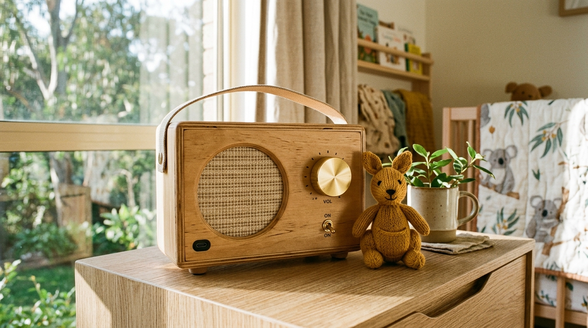
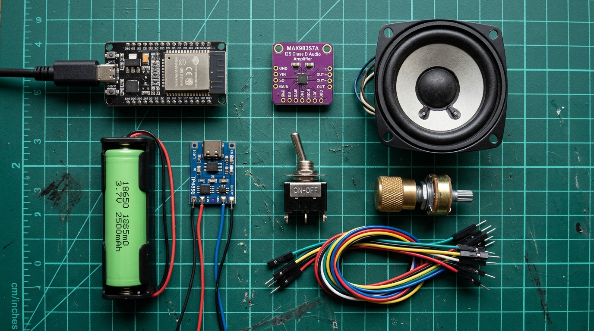
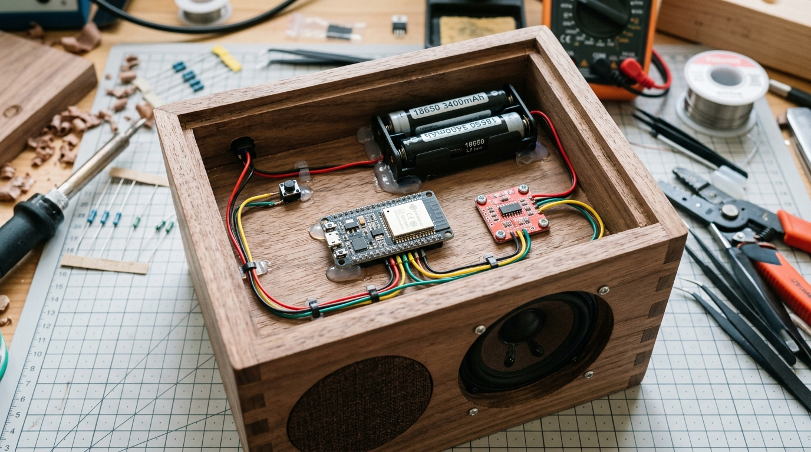

# 📻 Kangaroo Radio — DIY USB-C ABC Kids Radio

> **A beginner-friendly, zero-soldering guide to building a one-switch, USB-C rechargeable ABC Kids radio in Australia.**

[](https://richard-gluga.github.io/radio/)
[](https://richard-gluga.github.io/radio/#parts-guide)
[](https://richard-gluga.github.io/radio/#the-truth)



---

## 🌐 Live Interactive Guide
Visit the published interactive website with our **Live Budget Calculator**, **Acoustic Simulator**, **Interactive Pinout Explorer**, and **Wi-Fi Firmware Generator**:
👉 **[https://richard-gluga.github.io/radio/](https://richard-gluga.github.io/radio/)**

---

## ⚠️ The Important Catch: Why Analog FM Kits Won't Work
In Sydney (and across Australia), **ABC Kids Listen is not broadcast on analog AM or FM radio**. 

ABC Kids is a **digital-only station**:
1. **DAB+ (Digital Audio Broadcasting):** Sydney digital block 9C.
2. **Online Internet Stream:** High-quality direct MP3/AAC stream.

If you buy a traditional analog FM receiver kit, **it will be completely silent on ABC Kids**. 

### The Solution:
We build a dedicated **ESP32 Wi-Fi Radio**:
- Flick the physical toggle switch **ON**.
- It connects to your home Wi-Fi in ~2 seconds and immediately streams the official ABC Kids digital stream (`https://streaming.abc-cdn.net.au/audio/hls/abcextra.m3u8?source=web`).
- Sounds crystal clear through a high-efficiency **3.2W I2S digital amplifier** (zero analog static or indoor hiss).
- Rechargeable via **USB-C** with an internal 18650 lithium battery (12–18 hours battery life).

---

## 📸 Component Flat Lay


---

## 📻 Curated Child-Safe Live Stations (Allow-List)

The radio comes pre-configured with **6 verified, commercial-free or family-friendly live streams**. A single push button cycles through them:

| # | Station Name | Country / Network | Target Age | Description |
| :-: | :--- | :--- | :--- | :--- |
| **1** | **ABC Kids listen** | 🇦🇺 Australia (ABC) | Ages 0–6 | **Default startup station.** Stories, Play School, Kangaroo Beach, and early childhood songs. |
| **2** | **Fun Kids UK (Live)** | 🇬🇧 UK / Global | Ages 4–12 | Award-winning children's station: family-safe pop, science quizzes, and children's book readings. |
| **3** | **Fun Kids Junior** | 🇬🇧 UK / Global | Ages 0–4 | Soft nursery rhymes, animal songs, and gentle toddler bedtime stories. |
| **4** | **Rock the Cradle** | 🇺🇸 USA (Minnesota Public Radio) | All Ages | Commercial-free public radio for kids and parents. Indie folk and acoustic tunes. |
| **5** | **Positively Sleep Kids** | 🌙 Global | Bedtime | 24/7 calming lullabies, music box chimes, and ambient sleep soundscapes (no talking). |
| **6** | **ABC Classic (NSW)** | 🇦🇺 Australia (ABC) | All Ages | Peaceful classical music, ideal for Lego building, craft afternoons, and quiet resting. |

---

## 🛒 Bill of Materials & Australian Retailers

All components can be ordered from **[Core Electronics](https://core-electronics.com.au)** (Newcastle, NSW) in a single order, or via **Jaycar Electronics** across Sydney:

| Component | Exact Specification & Model | Est. Price (AUD) | Verified Direct Purchase Links |
| :--- | :--- | :--- | :--- |
| **Brain** | FireBeetle 2 ESP32-E (DFR0654) or DevKitC (DEV-19900) | ~$9.50 – $14 | [Core: FireBeetle 2 ESP32-E](https://core-electronics.com.au/firebeetle-2-esp32-e-iot-microcontroller.html) / [Jaycar: ESP32 (XC3800)](https://www.jaycar.com.au/esp32-main-development-board/p/XC3800) |
| **DAC & Amp** | Adafruit MAX98357A 3.2W I2S Class D Amp (ADA3006) | ~$6.90 – $10 | [Core: Adafruit MAX98357A](https://core-electronics.com.au/adafruit-i2s-3w-class-d-amplifier-breakout-max98357a.html) / [Core: SparkFun (DEV-14809)](https://core-electronics.com.au/sparkfun-i2s-audio-breakout-max98357a.html) |
| **Speaker** | Adafruit 3" 4Ω 3W Full-Range Speaker (ADA1314) | ~$6.50 | [Core: Adafruit 3" 4Ω 3W](https://core-electronics.com.au/speaker-3-diameter-4-ohm-3-watt.html) / [Jaycar: 50mm 4Ω (AS3004)](https://www.jaycar.com.au/mini-4-ohm-speaker-50mm/p/AS3004) |
| **Station Button** | 12mm / 16mm Tactile Momentary Push Button (NO) | ~$1.80 | [Core: 12mm Button (COM-09190)](https://core-electronics.com.au/momentary-pushbutton-switch-12mm-square.html) / [Jaycar: Pushbutton (SP0600)](https://www.jaycar.com.au/spst-standard-pushbutton-switch/p/SP0600) |
| **Battery** | 18650 3.7V ~2600mAh Cell + Single Slot Holder with Leads | ~$11.50 | [Jaycar: 18650 Cell (SB2423)](https://www.jaycar.com.au/18650-li-ion-rechargeable-battery-2600mah/p/SB2423) / [Jaycar: Holder (PH9201)](https://www.jaycar.com.au/1-x-18650-pcb-battery-holder/p/PH9201) / [Core: 2000mAh LiPo](https://core-electronics.com.au/polymer-lithium-ion-battery-2000mah.html) |
| **Charger & Boost** | Makerverse USB-C LiPo Charger (CE08374) + 5V Step-Up (POLOLU-2115) | ~$6.50 – $10 | [Core: USB-C Charger (CE08374)](https://core-electronics.com.au/makerverse-usb-c-lipo-charger.html) / [Core: Pololu 5V Boost](https://core-electronics.com.au/pololu-5v-step-up-voltage-regulator-u3v12f5.html) / [Amazon AU: 18650 Shield V3](https://www.amazon.com.au/s?k=18650+battery+shield+v3+type+c) |
| **Controls** | SPST Toggle Switch + 10kΩ Linear Potentiometer with Knob | ~$3.80 | [Core: Switch (COM-00102)](https://core-electronics.com.au/spdt-mini-power-switch.html) / [Core: 10k Pot (COM-09939)](https://core-electronics.com.au/rotary-potentiometer-10k-ohm-linear.html) / [Jaycar: Toggle (ST0570)](https://www.jaycar.com.au/spst-standard-toggle-switch/p/ST0570) |
| **Wiring** | Dupont Jumper Wires (40-pack F-to-F, 150mm) | ~$4.00 | [Core: 40pk F-F Jumpers (PRT-12794)](https://core-electronics.com.au/premium-female-female-jumper-wires-40-x-6-150mm.html) / [Jaycar: Leads (WC6024)](https://www.jaycar.com.au/40-piece-female-to-female-jumper-leads/p/WC6024) |
| **Enclosure** | Small Timber Craft Box | ~$5.00 | [Kmart Wooden Box](https://www.kmart.com.au/search/?searchTerm=wooden+box) / [Bunnings Craft Box](https://www.bunnings.com.au/search/products?q=craft+box) |

---

## ⚡ Engineering Compatibility & Safety Notes

1. **Power & Brownout Prevention (Critical!):**  
   Standard ESP32 development boards use an **AMS1117-3.3** voltage regulator which has a **~1.2V dropout voltage**. If you feed a 3.7V battery directly into the board's `VIN` pin, `3.7V - 1.2V = 2.5V`, causing the ESP32 to brownout and reset as soon as the Wi-Fi radio transmits!  
   👉 **Solution:** Use the **Pololu 5V Step-Up Booster** or an **All-in-One 18650 Battery Shield V3** to supply a clean, regulated **5.0V** to both the ESP32 and MAX98357A. (If using the *FireBeetle 2 ESP32-E*, its onboard ultra-low dropout regulator accepts 3.7V LiPo batteries directly).
2. **I2S Audio Clocking:**  
   The MAX98357A features an internal phase-locked loop (PLL) that automatically derives the master clock (MCLK) from the bit clock (`BCLK`). You only need **3 data wires** (`BCLK`, `LRC`, and `DIN`). No master clock wire is required.
3. **Station Push Button (Internal Pull-Up):**  
   Connect one terminal of the push button to **GPIO 33** and the other to **GND**. The ESP32's built-in `INPUT_PULLUP` resistor eliminates the need for any external resistors.
4. **Volume Potentiometer Voltage & Pin Selection:**  
   - Connect the potentiometer's power leg to **3.3V (NOT 5V!)**. The ESP32 analog pins are 3.3V max.
   - Use **GPIO 34**: On the ESP32, GPIO 34 belongs to **ADC1**. Channels on ADC2 are disabled when Wi-Fi is actively streaming; ADC1 pins work flawlessly during continuous Wi-Fi audio playback.

---

## 🔌 Pin-by-Pin Wiring Guide

Connect the components with standard push-on Dupont jumper wires:

```
    MAX98357A Pin         ESP32 Pin
   ────────────────     ─────────────
   LRC (Word Clock)  ──► GPIO 25
   BCLK (Bit Clock)  ──► GPIO 26
   DIN (Data In)     ──► GPIO 22
   GND               ──► GND
   VIN               ──► 5V (from Boost Converter or Shield)
   GAIN              ──► Leave Floating (defaults to 9dB)

    Station Button        ESP32 Pin
   ────────────────     ─────────────
   Terminal 1        ──► GPIO 33
   Terminal 2        ──► GND (uses internal pull-up)

    10k Volume Pot        ESP32 Pin
   ────────────────     ─────────────
   Leg 1 (VCC)       ──► 3.3V (NEVER 5V!)
   Leg 2 (Wiper)     ──► GPIO 34 (ADC1)
   Leg 3 (GND)       ──► GND

    Power System          Connections
   ───────────────     ─────────────────
   18650 Battery (+) ──► TP4056 B+
   18650 Battery (-) ──► TP4056 B-
   TP4056 OUT+       ──► Through SPST Toggle Switch ──► 5V Step-Up Boost IN+
   5V Boost OUT+     ──► ESP32 VIN & MAX98357A VIN
   Common GND        ──► All GND terminals connected together
```

---

## 📦 Cabinet Assembly


### The Secret to Great Sound:
Never run a speaker cone bare on a table! The sound wave from the back cancels out the sound from the front (acoustic phase cancellation), making it sound thin and squeaky. Mounting the speaker inside a **sealed wooden box** with a circular cutout traps the back wave, providing deep, warm room-filling acoustics.

---

## ⚡ Quick Start Firmware

1. Install [Arduino IDE](https://www.arduino.cc/en/software).
2. Add ESP32 boards manager URL in Preferences:
   ```
   https://raw.githubusercontent.com/espressif/arduino-esp32/gh-pages/package_esp32_index.json
   ```
3. In Library Manager, install **`ESP32-audioI2S`** (by *schreibfaul1*).
4. Open [`firmware/KangarooRadio_ABCKids.ino`](firmware/KangarooRadio_ABCKids.ino), enter your Wi-Fi credentials, and hit **Upload**!

---

## ⚠️ Common Gotchas
1. **2.4 GHz Wi-Fi Only:** The ESP32 cannot connect to 5GHz Wi-Fi networks. Ensure you connect to your router's 2.4GHz network.
2. **Australian Geoblocking:** ABC Kids streams are geoblocked to Australian IP addresses.
3. **Lithium Safety:** Always use a TP4056 board with integrated **DW01A battery protection** (identified by 4 solder pads: B+, B-, OUT+, OUT-).
4. **Car / Portable Use:** Add your mobile phone's hotspot name/password as a secondary network so the radio works on camping trips and road trips!

---

## 📄 License
MIT License. Open-source hardware and software guide for Australian makers and families.
